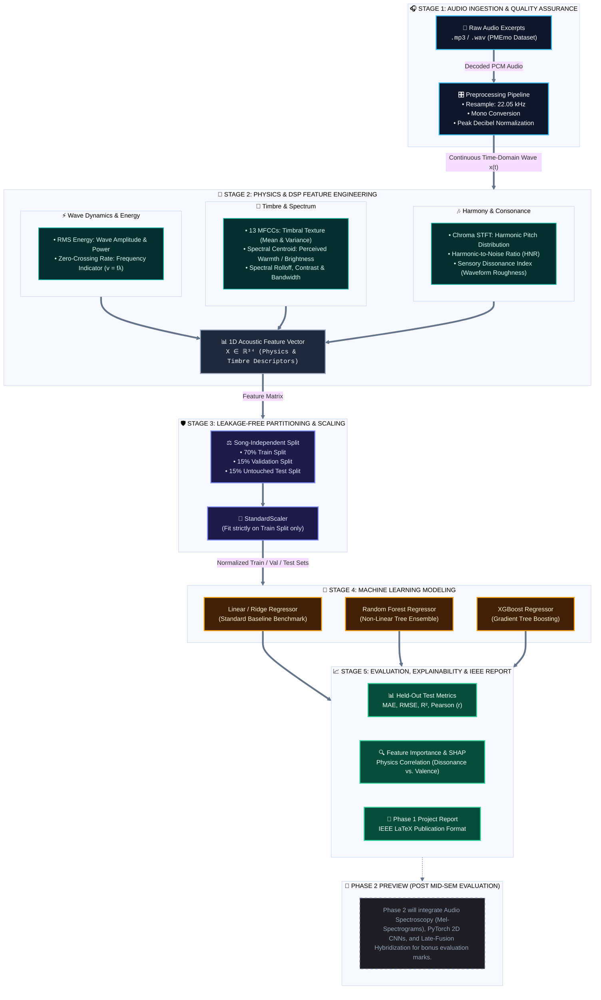

# 🎵 HarmoniX: The Science of Musical Perception
### Phase 1: Machine Learning & Physics-Informed Audio Analysis

> **Predicting Human-Rated Musical Valence from Sound Waves using Wave Physics, Digital Signal Processing, and Classical Machine Learning**

[-0284c7.svg?style=flat&logo=target)](https://github.com/adnan275/HarmoniX)
[](https://www.python.org/)
[](https://librosa.org/)
[](https://scikit-learn.org/)
[](https://xgboost.ai/)
[](reports/)

---

## 📖 1. Overview & Research Question

Music is universally perceived across cultures, evoking emotional responses regardless of linguistic or semantic comprehension. A person can listen to a piece in an unfamiliar language and still find it soothing, uplifting, energetic, or dissonant.

**HarmoniX (Phase 1)** investigates this phenomenon strictly through physical acoustics and classical machine learning:
> *If we remove lyrics and semantic meaning, to what extent can measurable acoustic, physical, and mathematical characteristics of sound waves predict human-rated musical valence (pleasantness)?*

Sound is fundamentally physical variations in atmospheric pressure over time. In Phase 1, we extract physics-grounded mathematical descriptors—governed by wave mechanics ($v = f \lambda$), Fourier transforms (STFT), harmonic ratios, and sensory dissonance—and train multiple machine learning regression models on a leakage-free dataset.

---

## 🏗️ 2. Phase 1 Machine Learning Architecture



---

## 👥 3. Phase 1 Team & Module Distribution

All 5 team members are assigned distinct, non-overlapping modules corresponding directly to the Phase 1 evaluation rubric:

| Team Member | Phase 1 Module | Target Script(s) | Viva & Evaluation Ownership |
| :--- | :--- | :--- | :--- |
| **Adnan Rizvi** *(Lead)* | **Dataset Ingestion & Quality EDA** | [`src/data_loader.py`](src/data_loader.py)<br/>[`src/inspect_dataset.py`](src/inspect_dataset.py)<br/>[`src/eda_analysis.py`](src/eda_analysis.py) | Dataset sanity checks, missing audio handling, reproducible 70/15/15 zero-leakage splitting, and target distribution EDA. |
| **Garariya** | **DSP & Physics Feature Engineering** | `src/feature_extraction.py` | Signal processing, wave equations ($v=f\lambda$), MFCC extraction, Spectral Centroid (warmth), RMS energy, and Dissonance computation. |
| **Bhoomi** | **Machine Learning Modeling & Tuning** | `src/train_ml.py` | Baseline Ridge Regression, Random Forest, and XGBoost regressor training with train-only scaling and cross-validation tuning. |
| **Praanshu Ranjan** | **Theoretical Rigor & Explainability** | `src/feature_analysis.py`<br/>`reports/figures/` | Feature correlation heatmaps, Dissonance vs. Valence curves, SHAP explainability, and feature importance analysis. |
| **Vani** | **Test Evaluation & IEEE Report** | `src/evaluate.py`<br/>`reports/phase1_report/` | Held-out test set metrics (MAE, RMSE, $R^2$), benchmark comparison tables, residual error plots, and IEEE LaTeX report authoring. |

---

## 📂 4. Repository Structure (Phase 1)

```text
AIML_project/
├── data/
│   ├── raw/PMEmo/               # Raw audio clips (.wav/.mp3) and static_annotations.csv
│   └── processed/               # Leakage-free train, val, and test split tables
├── src/
│   ├── data_loader.py           # [Adnan] Ingestion, audio matching & 70/15/15 splits
│   ├── inspect_dataset.py       # [Adnan] Dataset audit & decodability verification
│   ├── eda_analysis.py          # [Adnan] Distribution plots & Russell's 2D affect grid
│   ├── feature_extraction.py    # [Garariya] Physics & DSP acoustic feature extractor
│   ├── train_ml.py              # [Bhoomi] Classical ML modeling (Ridge, RF, XGBoost)
│   ├── feature_analysis.py      # [Praanshu] Feature importance & physical correlation
│   └── evaluate.py              # [Vani] Test evaluation benchmark & residual analysis
├── models/                      # Serialized trained model artifacts (.joblib)
├── reports/
│   ├── figures/                 # High-resolution figures for IEEE report and PPT
│   │   ├── 01_valence_distribution.png
│   │   ├── 02_valence_vs_arousal_space.png
│   │   └── 03_split_consistency_boxplot.png
│   ├── dataset_summary_statistics.csv
│   └── phase1_report/           # LaTeX source files for IEEE Phase 1 paper
├── requirements.txt             # Python dependencies
├── .gitignore                   # Excludes raw audio, binaries, and virtual environments
└── README.md                    # Project documentation
```

---

## ⚡ 5. Quickstart & Installation

### Step 1: Clone the Repository
```bash
git clone https://github.com/adnan275/HarmoniX.git
cd HarmoniX
```

### Step 2: Setup Python 3.11 Virtual Environment
```bash
python3.11 -m venv .venv
source .venv/bin/activate       # On Windows: .venv\Scripts\activate
pip install --upgrade pip
pip install -r requirements.txt
```

### Step 3: Run Ingestion & Generate Leak-Free Splits
```bash
python src/data_loader.py
```
*Outputs split files to `data/processed/train_split.csv`, `val_split.csv`, and `test_split.csv`.*

### Step 4: Generate Publication-Ready EDA Figures
```bash
python src/eda_analysis.py
```
*Visual figures are saved in `reports/figures/`.*

---

## 🔬 6. Phase 1 Evaluation Rubric Alignment

1. **Dataset Quality & EDA:** Audited sample rate, audio duration, missing values, and verified song-independent partitioning with zero target distribution shift.
2. **Feature Engineering & Rigor:** Features cover energy, spectral warmth, timbre, and harmonic roughness grounded in wave physics.
3. **Model Application:** Rigorous comparison between linear parametric (Ridge) and non-linear non-parametric (Random Forest, XGBoost) models.
4. **Data Leakage Safeguards:** Feature scaling (`StandardScaler`) is fitted strictly on training data; hyperparameter tuning uses validation splits only; final evaluation is performed once on held-out test data.
5. **Report & Viva Voce:** Full IEEE-format report detailing theoretical motivation, empirical results, and ablation analysis.

---

## 🔮 7. Phase 2 Roadmap (Post-Evaluation)
Following the Phase 1 evaluation, the team will implement **Phase 2: Deep Learning & Hybrid Approach**:
* **Audio Spectroscopy:** Log-Mel-Spectrogram image generation using Librosa.
* **Deep Learning Model:** PyTorch 2D Convolutional Neural Network (CNN) trained on spectrogram representations.
* **Hybrid Multi-Modal Fusion:** Combining tabular physics features with CNN latent embeddings for additional evaluation bonus marks.
* **Interactive Web Application:** Streamlit-based UI for uploading any unseen audio and receiving real-time predictions and acoustic breakdowns.
