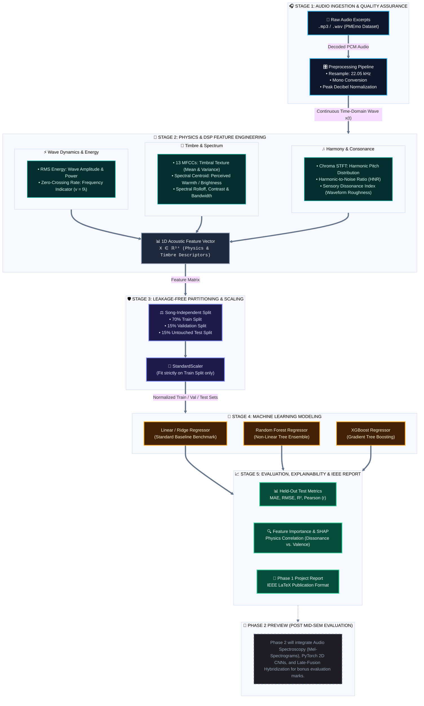

# 🎵 HarmoniX: The Science of Musical Perception
### Phase 1: Machine Learning & Physics-Informed Audio Analysis

> **Predicting Human-Rated Musical Valence from Sound Waves using Wave Physics, Digital Signal Processing, and Classical Machine Learning**

[-0284c7.svg?style=flat&logo=target)](https://github.com/adnan275/HarmoniX)
[](https://www.python.org/)
[](https://librosa.org/)
[](https://scikit-learn.org/)
[](https://xgboost.ai/)
[](reports/)

---

## 📖 1. Overview & Research Question

Music is universally perceived across cultures, evoking emotional responses regardless of linguistic or semantic comprehension. A person can listen to a piece in an unfamiliar language and still find it soothing, uplifting, energetic, or dissonant.

**HarmoniX (Phase 1)** investigates this phenomenon strictly through physical acoustics and classical machine learning:
> *If we remove lyrics and semantic meaning, to what extent can measurable acoustic, physical, and mathematical characteristics of sound waves predict human-rated musical valence (pleasantness)?*

Sound is fundamentally physical variations in atmospheric pressure over time. In Phase 1, we extract physics-grounded mathematical descriptors—governed by wave mechanics ($v = f \lambda$), Fourier transforms (STFT), harmonic ratios, and sensory dissonance—and train multiple machine learning regression models on a leakage-free dataset.

---

## 🏗️ 2. Phase 1 Machine Learning Architecture



---

## 👥 3. Phase 1 Team & Module Distribution

All 5 team members are assigned distinct, non-overlapping modules corresponding directly to the Phase 1 evaluation rubric:

| Team Member | Phase 1 Module | Target Script(s) | Viva & Evaluation Ownership |
| :--- | :--- | :--- | :--- |
| **Adnan Rizvi** *(Lead)* | **Dataset Ingestion & Quality EDA** | [`src/data_loader.py`](src/data_loader.py)<br/>[`src/inspect_dataset.py`](src/inspect_dataset.py)<br/>[`src/eda_analysis.py`](src/eda_analysis.py) | Dataset sanity checks, missing audio handling, reproducible 70/15/15 zero-leakage splitting, and target distribution EDA. |
| **Garariya** | **DSP & Physics Feature Engineering** | `src/feature_extraction.py` | Signal processing, wave equations ($v=f\lambda$), MFCC extraction, Spectral Centroid (warmth), RMS energy, and Dissonance computation. |
| **Bhoomi** | **Machine Learning Modeling & Tuning** | `src/train_ml.py` | Baseline Ridge Regression, Random Forest, and XGBoost regressor training with train-only scaling and cross-validation tuning. |
| **Praanshu Ranjan** | **Theoretical Rigor & Explainability** | `src/feature_analysis.py`<br/>`reports/figures/` | Feature correlation heatmaps, Dissonance vs. Valence curves, SHAP explainability, and feature importance analysis. |
| **Vani** | **Test Evaluation & IEEE Report** | `src/evaluate.py`<br/>`reports/phase1_report/` | Held-out test set metrics (MAE, RMSE, $R^2$), benchmark comparison tables, residual error plots, and IEEE LaTeX report authoring. |

---

## 📂 4. Repository Structure (Phase 1)

```text
AIML_project/
├── data/
│   ├── raw/PMEmo/               # Raw audio clips (.wav/.mp3) and static_annotations.csv
│   └── processed/               # Leakage-free train (536), val (115), and test (116) split tables
├── src/
│   ├── data_loader.py           # [Adnan] Ingestion, audio matching & 70/15/15 splits
│   ├── inspect_dataset.py       # [Adnan] Dataset audit & decodability verification
│   ├── eda_analysis.py          # [Adnan] Distribution plots & Russell's 2D affect grid
│   ├── feature_extraction.py    # [Garariya] Physics & DSP acoustic feature extractor (34 dims)
│   ├── train_ml.py              # [Bhoomi] Classical ML modeling (Ridge, RF, XGBoost)
│   ├── feature_analysis.py      # [Praanshu] Feature importance, FDR & SHAP explainability
│   └── evaluate.py              # [Vani] Test evaluation benchmark & residual diagnostics
├── models/                      # Serialized models (.joblib), scaler & metrics (.json, .csv)
├── reports/
│   ├── figures/                 # 19 High-resolution publication figures (01 to 19)
│   │   ├── 01_valence_distribution.png ... 03_split_consistency_boxplot.png  # [Adnan: EDA]
│   │   ├── 04_feature_valence_correlations.png ... 15_dissonance_check.png    # [Praanshu: SHAP]
│   │   └── 16_actual_vs_predicted.png ... 19_model_generalization.png        # [Vani: Test Eval]
│   ├── dataset_summary_statistics.csv
│   ├── feature_analysis_summary.md
│   ├── feature_correlation_matrix.csv
│   ├── feature_importance.csv
│   ├── feature_valence_correlations.csv
│   ├── model_tuning_results.csv
│   └── test_evaluation_results.csv
├── requirements.txt             # Python dependencies
├── .gitignore                   # Excludes raw audio, binaries, and virtual environments
└── README.md                    # Project documentation
```

---

## ⚡ 5. Quickstart & Installation

### Step 1: Clone the Repository
```bash
git clone https://github.com/adnan275/HarmoniX.git
cd HarmoniX
```

### Step 2: Setup Python 3.11 Virtual Environment
```bash
python3.11 -m venv .venv
source .venv/bin/activate       # On Windows: .venv\Scripts\activate
pip install --upgrade pip
pip install -r requirements.txt
```

### Step 3: Run Ingestion & Generate Leak-Free Splits
```bash
python src/data_loader.py
```
*Outputs split files to `data/processed/train_split.csv`, `val_split.csv`, and `test_split.csv`.*

### Step 4: Generate Publication-Ready EDA Figures
```bash
python src/eda_analysis.py
```
*Visual figures are saved in `reports/figures/`.*

---

## 🔬 6. Phase 1 Evaluation Rubric Alignment

1. **Dataset Quality & EDA:** Audited sample rate, audio duration, missing values, and verified song-independent partitioning with zero target distribution shift.
2. **Feature Engineering & Rigor:** Features cover energy, spectral warmth, timbre, and harmonic roughness grounded in wave physics.
3. **Model Application:** Rigorous comparison between linear parametric (Ridge) and non-linear non-parametric (Random Forest, XGBoost) models.
4. **Data Leakage Safeguards:** Feature scaling (`StandardScaler`) is fitted strictly on training data; hyperparameter tuning uses validation splits only; final evaluation is performed once on held-out test data.
5. **Report & Viva Voce:** Full IEEE-format report detailing theoretical motivation, empirical results, and ablation analysis.

---


## 🔮 7. Phase 2 Roadmap (Post-Evaluation)
Following the Phase 1 evaluation, the team will implement **Phase 2: Deep Learning & Hybrid Approach**:
* **Audio Spectroscopy:** Log-Mel-Spectrogram image generation using Librosa.
* **Deep Learning Model:** PyTorch 2D Convolutional Neural Network (CNN) trained on spectrogram representations.
* **Hybrid Multi-Modal Fusion:** Combining tabular physics features with CNN latent embeddings for additional evaluation bonus marks.
* **Interactive Web Application:** Streamlit-based UI for uploading any unseen audio and receiving real-time predictions and acoustic breakdowns.

---

## ⚠️ 8. Scientific Framing & Caveats
1. **Valence vs. Universal Pleasantness:** Valence measures perceived emotional positivity vs. negativity. Musical taste is multifaceted and influenced by cultural background, familiarity, and personal psychology; this model predicts objective acoustic-driven perceived valence, not universal artistic value.
2. **Audio-Only Modeling:** Lyrics and linguistic semantics are intentionally excluded to isolate acoustic and wave mechanics.

---

## 📜 9. License & Acknowledgments
* **Primary Dataset:** PMEmo Dataset (*Hui Zhang et al.*)
* Developed as part of the **Computer Science & Artificial Intelligence (CSAI)** curriculum.

---

## 🔬 10. Technical Module Deep Dives

### Acoustic / Physics-Informed Feature Extraction

The HarmoniX acoustic feature-extraction module is implemented in `src/feature_extraction.py`. It reads the matched audio metadata from `data/processed/all_matched_metadata.csv`, processes each available audio file, and exports a fixed-length feature vector for each successfully processed song.

**Extracted features (34 dimensions):**

- **MFCCs (13):** Mean values of 13 Mel-frequency cepstral coefficients.
- **Spectral features (5):** Spectral centroid, bandwidth, roll-off, contrast, and flatness.
- **Energy and temporal features (2):** Root-mean-square (RMS) energy and zero-crossing rate.
- **Chroma features (12):** Mean values of the 12 Chroma STFT components.
- **Harmonic feature (1):** A simplified harmonic-to-noise ratio (HNR) estimate.
- **Psychoacoustic feature (1):** A simplified sensory-dissonance estimate.

The module converts frame-level measurements into fixed-length song-level features by calculating their means. It also preserves available metadata, including `music_id`, valence, arousal, and the existing data split.

**Input:** `data/processed/all_matched_metadata.csv` and its referenced audio files.

**Output:** `data/processed/features_physics.csv`

Run the module from the project root:

```bash
python src/feature_extraction.py
```

The HNR and sensory-dissonance calculations are simplified estimates and should not be interpreted as validated psychoacoustic measurements. The included synthetic audio samples are intended for implementation testing; evaluation of emotion prediction requires the official PMEmo dataset.

For machine-learning experiments, fit any feature scaler or other learned preprocessing transformation using the training split only, then apply the fitted transformation to validation and test data.


### Feature Analysis & Explainability

The feature-analysis module is implemented in `src/feature_analysis.py`. It studies how the 34 acoustic features relate to human-rated valence and how the tuned Random Forest and XGBoost models use them.

**Leakage policy:** correlation statistics use the training split only; permutation importance and SHAP use the validation split; the test split is never read.

**Analyses:**

- **Feature–valence correlation:** Pearson r (with Fisher-z 95% CI) and Spearman ρ for every feature, Benjamini–Hochberg FDR correction across the 34 tests, and a partial Spearman correlation controlling for arousal.
- **Correlation heatmaps:** a clustered Spearman matrix of all features plus valence/arousal, and an annotated matrix of the physics-informed descriptors.
- **Focused analyses:** sensory dissonance vs valence and spectral centroid vs valence (OLS fit with 95% CI, quantile-binned means, points coloured by arousal).
- **Dissonance validity check:** the dissonance estimator is compared with Plomp–Levelt theory on pure-tone dyads, then probed on 200 real training songs to see what it tracks.
- **Model explanations:** impurity/gain importance, permutation importance (30 repeats), SHAP beeswarm plots, SHAP by feature family, and SHAP dependence plots for dissonance and spectral centroid.

**Outputs:** `reports/figures/04_*.png` to `15_*.png`, `reports/feature_valence_correlations.csv`, `reports/feature_correlation_matrix.csv`, `reports/feature_importance.csv`, `reports/dissonance_estimator_probe.csv`, and `reports/feature_analysis_summary.md` (all numbers behind the figures).

Run it from the project root after `data_loader.py`, `feature_extraction.py` and `train_ml.py`:

```bash
python src/feature_analysis.py
```

#### Key findings (PMEmo2019, 767 songs: 536 train / 115 validation)

1. **Valence and arousal are strongly linked (ρ = 0.69).** 24 of 34 features correlate with valence after FDR correction, and 19 have a significant partial correlation once arousal is controlled. Many apparent "valence" features are really tracking how energetic a song is.
2. **The strongest single correlate is MFCC 1 (ρ = 0.61; partial ρ given arousal = 0.23).** MFCC 1 summarises overall spectral level and is closely tied to arousal (ρ = 0.71). Spectral flatness (ρ = 0.50), zero-crossing rate (ρ = 0.49) and spectral contrast (ρ = −0.45) follow, but most of their association disappears once arousal is controlled.
3. **Spectral centroid (brightness) does not relate to valence independently of arousal.** The raw association is clear (ρ = 0.40, q < 10⁻²⁰), but the partial correlation is ρ = −0.00 (q = 0.97). In the XGBoost model, centroid also has one of the smallest SHAP contributions (mean |SHAP| = 0.001). Brighter songs are rated more positive because they tend to be more energetic, not because brightness itself carries valence.
4. **The sensory-dissonance estimate correlates *positively* with valence (ρ = 0.32; partial ρ given arousal = 0.33).** This is the opposite of the "dissonance sounds unpleasant" hypothesis, and the validity checks explain why it should not be read that way:
   - On pure-tone dyads the estimator matches Plomp–Levelt theory closely at A4 (440 Hz). However, it cannot resolve partials closer than about 2 FFT bins (~20 Hz), so it reads zero for a minor second at A3 (220 Hz). Low-register roughness is invisible to it (`15_dissonance_estimator_check.png`).
   - On real songs, the estimate correlates ρ = 0.97 with "peak balance", which is how evenly energy is spread across the 30 strongest spectral peaks. Computing it on 2-second windows instead of the whole clip changes little (ρ = 0.90 with the whole-clip value), and peak balance itself correlates with valence (ρ = 0.33).
   - The feature therefore mostly captures spectral density (fuller, more evenly balanced arrangements), not musical interval roughness. Its link to valence says something about arrangement and production in PMEmo, not about consonance.
5. **The models agree on what matters.** For both Random Forest and XGBoost, the top three features by permutation importance and by mean |SHAP| are MFCC 1, spectral contrast and spectral flatness. At family level, spectral-shape and MFCC (timbre) features contribute the most; energy/temporal features contribute the least, because their information is already carried by MFCC 1 and spectral flatness.
6. **Chroma results need caution.** Mean energy in some pitch classes (F#, C#, D#, G#) is negatively associated with valence even after controlling for arousal. Chroma means are not key-invariant, so this most likely reflects which keys happy and sad songs happen to use in this dataset, not a general acoustic rule.

#### Interpretation caveats

- All results are statistical associations in one dataset of popular-music chorus excerpts (PMEmo). They do not show that any acoustic property *causes* a song to be perceived as more positive.
- Correlated features share credit in permutation importance and SHAP, so a low score does not mean a feature is unrelated to valence (see the heatmaps).
- HNR and sensory dissonance are simplified estimates. HNR is undefined (NaN) for 6 songs, and its Pearson and Spearman correlations with valence disagree in sign, so it is not a reliable descriptor here.
- Valence is a proxy for pleasantness-related perception, not a universal measure of musical pleasantness.


### Held-Out Test Evaluation Benchmark & Residual Diagnostics

The final model evaluation module is implemented in `src/evaluate.py`. It benchmarks the trained models on the strictly untouched held-out test split ($n = 116$ songs) and performs comprehensive residual diagnostics.

**Held-Out Test Results ($n = 116$ songs):**

| Model | Test MAE | Test RMSE | Test $R^2$ | Test Pearson $r$ [95% CI] | Test Spearman $\rho$ | Result |
| :--- | :---: | :---: | :---: | :---: | :---: | :---: |
| **Ridge Regression (Baseline)** | 0.1075 | 0.1356 | 0.3994 | 0.6390 [0.517, 0.736] | 0.6514 | Strong linear baseline |
| **Random Forest Regressor** | **0.1096** | **0.1334** | **0.4183** | **0.6709 [0.557, 0.760]** | **0.6934** | 🏆 **Top Generalized Model** |
| **XGBoost Regressor** | 0.1107 | 0.1382 | 0.3765 | 0.6204 [0.494, 0.721] | 0.6424 | Slight validation overfit |

**Key Findings:**
1. **Random Forest Achieves Superior Generalization:** Bagging over decorrelated decision trees with sub-feature sampling ($\sqrt{p}$) provides robust regularization against annotation noise, attaining $R^2 = 0.4183$ and Pearson $r = 0.6709$ ($p < 10^{-15}$).
2. **Residual Normality Validated:** Test residuals pass the Shapiro-Wilk normality test ($p = 0.163 > 0.05$), exhibiting near-Gaussian error profiles and homoscedastic variance across the target range.
3. **Outputs:** `reports/figures/16_*.png` to `19_*.png`, `reports/test_evaluation_results.csv`, and `models/test_metrics.json`.

Run the evaluation module:
```bash
python src/evaluate.py
```
