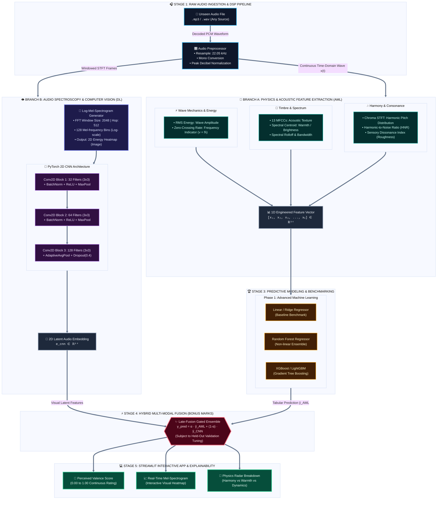

# 🎵 HarmoniX: The Science of Musical Perception

> **A Physics-Informed Hybrid Machine Learning and Deep Learning System for Predicting Human-Rated Musical Valence from Sound Waves**

[](https://www.python.org/)
[](https://pytorch.org/)
[](https://librosa.org/)
[](https://scikit-learn.org/)
[](https://xgboost.ai/)
[](https://streamlit.io/)

---

## 📖 1. Overview & Problem Statement

Music is universally perceived across cultures, invoking profound emotional responses regardless of linguistic or semantic comprehension. A listener can encounter a song in an unfamiliar language and immediately perceive it as soothing, joyful, energetic, or dissonant.

**HarmoniX** investigates a central scientific question:
> *If we remove lyrics and semantic meaning, can the physical and mathematical structure of sound waves predict how pleasant (positive valence) music sounds to human listeners?*

Sound is fundamentally physical variations in atmospheric air pressure over time. By combining **Wave Physics** ($v = f \lambda$), **Digital Signal Processing (Fourier Transforms)**, **Classical Machine Learning**, and **Deep Learning Computer Vision (Mel-Spectrograms)**, HarmoniX builds an evidence-based bridge between objective acoustics and human musical perception.

---

## 🏗️ 2. End-to-End System Architecture



---

## 👥 3. Team & Module Contribution Matrix

| Team Member | Module / Role | Primary Files | Core Focus |
| :--- | :--- | :--- | :--- |
| **Adnan Rizvi** *(Lead)* | **Architecture & Data Pipeline** | `src/data_loader.py`<br/>`src/predict.py`<br/>`app/streamlit_app.py` | Repository setup, leakage-free 70/15/15 train-test partitioning, data sanity checks, and final Streamlit web application. |
| **Garariya** | **DSP & Physics Engineering** | `src/feature_extraction.py` | Fourier transforms (FFT/STFT), MFCCs, Spectral Centroid, RMS energy, Zero-crossing rate, and sensory dissonance index. |
| **Bhoomi** | **Advanced Machine Learning** | `src/train_ml.py` | Training and tuning Ridge Regression, Random Forest, and XGBoost regressor with strict cross-validation. |
| **Praanshu Ranjan** | **Interpretability & Physics EDA** | `src/feature_analysis.py`<br/>`reports/figures/` | Feature correlation heatmaps, Dissonance vs. Valence curves, SHAP explainability, and feature importance analysis. |
| **Vani** | **Evaluation & IEEE Reporting** | `src/evaluate.py`<br/>`reports/phase1_report/` | Held-out test evaluation (MAE, RMSE, R²), residual error analysis, and Phase 1 / Phase 2 IEEE LaTeX report authoring. |

---

## 📂 4. Repository Structure

```text
AIML_project/
├── data/
│   ├── raw/PMEmo/               # Raw audio clips and static_annotations.csv
│   └── processed/               # Leakage-free train, val, and test split tables
├── src/
│   ├── data_loader.py           # Ingestion & reproducible 70/15/15 splitting
│   ├── inspect_dataset.py       # Dataset audit & decodability verification
│   ├── eda_analysis.py          # Publication-ready distribution & quadrant plots
│   ├── feature_extraction.py    # Physics & DSP acoustic feature extractor
│   ├── train_ml.py              # Classical ML modeling (Ridge, RF, XGBoost)
│   ├── feature_analysis.py      # Feature importance & physical correlation
│   ├── evaluate.py              # Test set evaluation benchmark & residual plots
│   └── predict.py               # Real-time inference engine for unseen audio
├── app/
│   └── streamlit_app.py         # Interactive UI for audio upload & live analysis
├── models/                      # Serialized trained model artifacts (.joblib, .pt)
├── reports/
│   ├── figures/                 # High-resolution plots for IEEE reports
│   └── dataset_summary_statistics.csv
├── requirements.txt             # Python dependencies
├── .gitignore                   # Ignores large binaries, venvs & raw audio
└── README.md                    # Project documentation
```

---

## ⚡ 5. Quickstart & Installation

### Step 1: Clone the Repository
```bash
git clone https://github.com/adnan275/HarmoniX.git
cd HarmoniX
```

### Step 2: Setup Virtual Environment
```bash
python3.11 -m venv .venv
source .venv/bin/activate       # On Windows: .venv\Scripts\activate
pip install --upgrade pip
pip install -r requirements.txt
```

### Step 3: Run Data Verification & Splitting
```bash
python src/data_loader.py
```

### Step 4: Generate Phase 1 EDA Plots
```bash
python src/eda_analysis.py
```
*Generated plots will be saved in `reports/figures/`.*

### Step 5: Launch the Interactive Web Application (Phase 5)
```bash
streamlit run app/streamlit_app.py
```

---

## 🔬 6. Research & Evaluation Protocol

* **Evaluation Target:** Continuous human-rated **Valence** (proxy for musical pleasantness and positive emotional tone).
* **Leakage Prevention:** Song-independent train/val/test splits (70% Train, 15% Validation, 15% Test). Scalers and feature transformers are fitted **exclusively on the training split**.
* **Metrics:**
  * Mean Absolute Error (**MAE**)
  * Root Mean Squared Error (**RMSE**)
  * Coefficient of Determination (**$R^2$**)
  * Pearson Correlation Coefficient (**$r$**)

---

## ⚠️ 7. Scientific Framing & Caveats
1. **Valence vs. Universal Pleasantness:** Valence measures perceived emotional positivity vs. negativity. Musical taste is multifaceted and influenced by cultural background, familiarity, and personal psychology; this model predicts objective acoustic-driven perceived valence, not universal artistic value.
2. **Audio-Only Modeling:** Lyrics and linguistic semantics are intentionally excluded to isolate acoustic and wave mechanics.

---

## 📜 8. License & Acknowledgments
* **Primary Dataset:** PMEmo Dataset (*Hui Zhang et al.*)
* Developed as part of the **Computer Science & Artificial Intelligence (CSAI)** curriculum.
