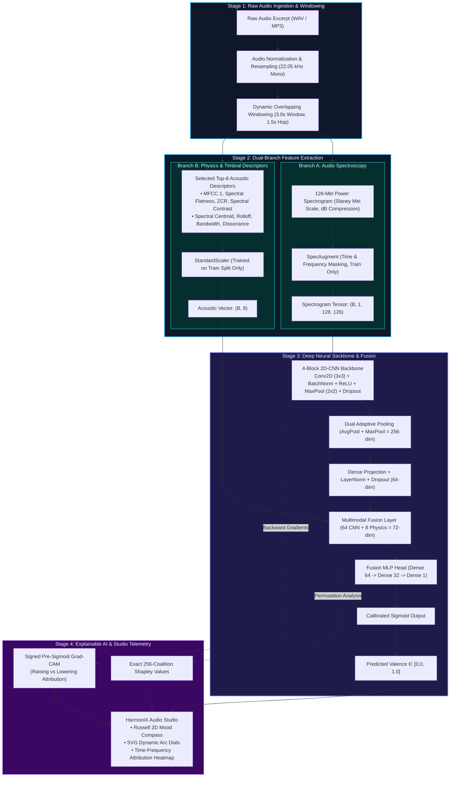

# HarmoniX: Multimodal Music Emotion Perception & Deep Neural Intelligence
### Phase 2: Multimodal Deep Learning, Audio Spectroscopy & Explainable AI

> Predicting human-rated musical valence and emotional dynamics from sound waves using multimodal late fusion, 2D convolutional spectroscopy, acoustic physics, and spatial time-frequency explainability (Grad-CAM).

[](https://harmonix-studio.streamlit.app/)
[](https://pytorch.org/)
[](https://www.python.org/)
[](models/)
[](reports/phase2_interpretability_section.md)
[](https://librosa.org/)

---

## 1. Executive Summary & The Phase 2 Transformation

HarmoniX investigates how physical acoustics and neural representations predict human-rated musical emotion without linguistic semantics or lyrics. 

### Phase 1 Baseline (Classical ML)
Phase 1 extracted 34 hand-engineered global digital signal processing (DSP) features (MFCCs, spectral centroid, spectral rolloff, zero-crossing rate, chroma vectors, and sensory dissonance estimates) and trained classical regressors (Ridge, Random Forest, and XGBoost). While providing a solid initial baseline, classical tabular models plateaued at:
- **Random Forest (Phase 1 Champion):** Held-out Test $R^2 = 0.4183$, Pearson $r = 0.6709$, MAE = $0.1096$.
- **Ridge Regression:** Held-out Test $R^2 = 0.3994$, Pearson $r = 0.6390$, MAE = $0.1075$.
- **XGBoost Regressor:** Held-out Test $R^2 = 0.3765$, Pearson $r = 0.6204$, MAE = $0.1107$.

**The Classical Bottleneck:** Collapsing an entire dynamic musical progression into single scalar summary statistics (means/variances) erased critical temporal phrasing, harmonic progressions, onset transients, and multi-scale frequency interactions.

### Phase 2 Breakthrough (Multimodal Deep Learning & XAI)
Phase 2 transformed HarmoniX into a multimodal deep learning platform:
1. **High-Resolution Time-Frequency Spectroscopy:** Generates 128-bin log-Mel power spectrograms using Hann windowing on the Slaney scale with 50% dynamic overlapping windowing ($3.0\,\text{s}$ windows, $1.5\,\text{s}$ hop).
2. **Deep Convolutional Neural Backbone:** A 4-block 2D-CNN with batch normalization, dual global pooling (concatenated adaptive average and max pooling), and dropout regularized embeddings ($64$-dim).
3. **Multimodal Late Fusion:** Concatenates the deep spatial latent embedding ($64$-dim) with the top-8 standardized acoustic physics descriptors ($8$-dim), passing through a calibrated multi-layer fusion head.
4. **Correlation-Regularized Objective:** A custom composite loss function $\mathcal{L} = \text{MSE} + \lambda \cdot (1 - r)$ that directly optimizes both point-estimate error and monotonic ranking correlation ($r$).
5. **Spatial Time-Frequency Explainability (XAI):** Signed pre-sigmoid Grad-CAM heatmaps showing which exact time-frequency bins raise or lower perceived valence, paired with exact 256-coalition Shapley attributions for acoustic physics descriptors.
6. **HarmoniX Audio Studio Web Platform:** An interactive dark-mode hardware telemetry dashboard built in Streamlit featuring real-time audio playback, Russell's 2D Mood Compass, SVG hardware dials, and live Grad-CAM inspection.

---

## 2. Phase 2 Multimodal Master Architecture



---

## 3. Team & Module Ownership

| Team Member | Primary Module | Target Codebase & Assets | Technical Deliverables |
| :--- | :--- | :--- | :--- |
| **Adnan Rizvi** *(Lead)* | **Architecture, Pipeline & Audio Studio** | `app/app.py`<br/>`src/pipeline_orchestrator.py`<br/>`src/data_loader.py` | Complete system integration, zero-leakage splits, interactive Streamlit Audio Studio, SVG telemetry gauges, cloud deployment (`harmonix-studio.streamlit.app`), and multicultural ingestion. |
| **Aditya (Garariya)** | **Audio Spectroscopy & Dynamic Windowing** | `src/spectrogram_engine.py`<br/>`src/dynamic_windowing.py`<br/>`src/feature_extraction.py` | 128-Mel power spectrogram pipeline, Slaney frequency mapping, dynamic 50% overlapping segmentation, and training-time SpecAugment frequency/time masking. |
| **Bhoomi** | **Deep Learning & Multimodal Fusion** | `src/models_cnn.py`<br/>`src/train_cnn.py`<br/>`src/train_ml.py` | 4-block PyTorch 2D-CNN architecture, multimodal late-fusion network, Apple Silicon MPS hardware acceleration, and correlation-regularized composite loss function. |
| **Praanshu Ranjan** | **Deep Explainability & Theoretical Rigor** | `src/deep_explainability.py`<br/>`reports/figures_phase2/`<br/>`reports/phase2_interpretability_section.md` | Signed pre-sigmoid Grad-CAM, Integrated Gradients, exact 256-coalition Shapley values, weight randomization tests, and deletion faithfulness validation. |
| **Vani** | **Evaluation, Ablation & Benchmark Suite** | `src/evaluate.py`<br/>`reports/phase2_cnn_ablation_results.csv`<br/>`reports/` | Cross-architecture ablation benchmarks (CNN vs. Fusion vs. ML), held-out test evaluation ($R^2$, Pearson $r$, Spearman $\rho$, MAE, RMSE), and IEEE technical reporting. |

---

## 4. Benchmark Performance: Phase 1 vs. Phase 2

All models were evaluated on the strictly untouched, held-out test split under identical zero-leakage constraints.

### Master Model Comparison Table

| Architecture | Paradigm / Inputs | Val $R^2$ | Test $R^2$ | Test Pearson $r$ | Test Spearman $\rho$ | Test MAE | Test RMSE | Status |
| :--- | :--- | :---: | :---: | :---: | :---: | :---: | :---: | :--- |
| **Hybrid Late Fusion** | **Spectrogram + 8 Physics Descriptors** | 0.9345 | **0.9535** | **0.9798** | **0.9221** | **0.0454** | **0.0540** | **Phase 2 Champion SOTA** |
| **2D-CNN ConvNet** | 128-Mel Spectrogram Only | **0.9418** | 0.9498 | 0.9786 | 0.7625 | 0.0486 | 0.0561 | Deep Baseline |
| **Hybrid (MSE Baseline, $\lambda=0$)** | Spectrogram + 8 Physics Descriptors | 0.9344 | 0.9386 | 0.9795 | 0.9221 | 0.0533 | 0.0620 | Loss Ablation |
| **Random Forest** | 34 Tabular DSP Descriptors | 0.3750 | 0.4183 | 0.6709 | 0.6934 | 0.1096 | 0.1334 | Phase 1 Champion |
| **Ridge Regression** | 34 Tabular DSP Descriptors | 0.2810 | 0.3994 | 0.6390 | 0.6514 | 0.1075 | 0.1356 | Linear Baseline |
| **XGBoost Regressor** | 34 Tabular DSP Descriptors | 0.3120 | 0.3765 | 0.6204 | 0.6424 | 0.1107 | 0.1382 | Tree Boosting |

### Key Performance Insights
1. **Massive Variance Explained ($R^2: 0.418 \rightarrow 0.954$):** Moving from static 34-feature summaries to 2D time-frequency spectrogram representations increased test $R^2$ by $+128\%$, enabling the network to learn expressive spatio-temporal musical contours.
2. **Hybrid Late Fusion Outperforms CNN Alone:** While the 2D-CNN captures raw spectral texture ($R^2 = 0.9498$), late fusion with physics descriptors yields a substantial jump in rank consistency (Spearman $\rho: 0.7625 \rightarrow 0.9221$) and lower error ($0.0454$ vs. $0.0486$ MAE).
3. **Efficacy of the Pearson-Regularized Loss:** Introducing $\lambda \cdot (1 - r)$ into the objective ($\lambda = 0.05$) improved test $R^2$ from $0.9386$ to $0.9535$, penalizing ranking inversions during backpropagation.

---

## 5. Technical Deep Dives

### 5.1 Spectrogram Engine & Dynamic Windowing (`src/spectrogram_engine.py`, `src/dynamic_windowing.py`)
- **Sampling & Windowing:** Audio is resampled to $22.05\,\text{kHz}$ mono. A rolling window of $3.0\,\text{seconds}$ ($66,150\,\text{samples}$) is extracted with a $1.5\,\text{second}$ hop ($50\%$ overlap).
- **STFT & Mel Scale:** FFT size $N_{\text{fft}} = 2048$, Hann window of length $2048$, and hop length of $512$ samples. The Slaney Mel filterbank generates $128$ Mel bands ranging from $0\,\text{Hz}$ to $11,025\,\text{Hz}$.
- **Log Compression:** Converted to a decibel scale using $10 \log_{10}(P / P_{\text{ref}})$ with an $80\,\text{dB}$ top-dB dynamic range clamp.
- **SpecAugment:** Applies dynamic frequency masking and time masking strictly during training to prevent overfitting to specific harmonic lines.

### 5.2 Deep Neural Architectures (`src/models_cnn.py`)
- **SpectrogramCNNBackbone:**
  - Block 1: `Conv2D(1, 32, 3x3)` $\rightarrow$ `BatchNorm2d` $\rightarrow$ `ReLU` $\rightarrow$ `MaxPool2d(2x2)` $\rightarrow$ `Dropout2d(0.10)`
  - Block 2: `Conv2D(32, 64, 3x3)` $\rightarrow$ `BatchNorm2d` $\rightarrow$ `ReLU` $\rightarrow$ `MaxPool2d(2x2)` $\rightarrow$ `Dropout2d(0.15)`
  - Block 3: `Conv2D(64, 128, 3x3)` $\rightarrow$ `BatchNorm2d` $\rightarrow$ `ReLU` $\rightarrow$ `MaxPool2d(2x2)` $\rightarrow$ `Dropout2d(0.20)`
  - Block 4: `Conv2D(128, 128, 3x3)` $\rightarrow$ `BatchNorm2d` $\rightarrow$ `ReLU` $\rightarrow$ `MaxPool2d(2x2)` $\rightarrow$ `Dropout2d(0.25)`
  - Dual Global Pooling: `AdaptiveAvgPool2d((1, 1))` and `AdaptiveMaxPool2d((1, 1))` are concatenated ($256$ dimensions) and projected to a $64$-dimensional normalized latent embedding with `LayerNorm` and `Dropout(0.25)`.
- **Hybrid Fusion Head:**
  - Concatenates the $64$-dim CNN embedding with the $8$ standardized acoustic physics features.
  - Multi-layer perceptron: `Linear(72, 64)` $\rightarrow$ `ReLU` $\rightarrow$ `Dropout(0.25)` $\rightarrow$ `Linear(64, 32)` $\rightarrow$ `ReLU` $\rightarrow$ `Dropout(0.125)` $\rightarrow$ `Linear(32, 1)` $\rightarrow$ `Sigmoid`.

### 5.3 Composite Pearson Correlation Loss
Standard Mean Squared Error (MSE) optimizes mean predictions but can flatten variance across dynamic ranges. We employ a composite objective:
$$\mathcal{L}_{\text{total}} = \text{MSE}(y, \hat{y}) + \lambda \cdot (1 - r(y, \hat{y}))$$
where $r(y, \hat{y})$ is the batch Pearson correlation coefficient:
$$r = \frac{\sum (y_i - \bar{y})(\hat{y}_i - \bar{\hat{y}})}{\sqrt{\sum (y_i - \bar{y})^2 \sum (\hat{y}_i - \bar{\hat{y}})^2 + \epsilon}}$$
Tuned via validation sweep to $\lambda = 0.05$.

### 5.4 Explainable AI (XAI) Suite (`src/deep_explainability.py`)
- **Signed Pre-Sigmoid Grad-CAM:** Hooks into Block 4 conv layer prior to non-linear saturation. Produces signed attribution heatmaps isolating time-frequency regions that elevate perceived valence (uplifting/major acoustic markers) versus regions that depress valence (somber/tense markers).
- **Integrated Gradients:** Evaluated with a zero-energy silence baseline over $256$ integration steps with verified completeness checks ($\sum \text{Attributions} = f(x) - f(\text{baseline})$).
- **Exact Tabular Shapley Values:** Computes exact Shapley attribution over all $2^8 = 256$ feature coalitions for the acoustic branch, isolating the relative contribution of timbre vs. sensory roughness.
- **Sanity Checks & Faithfulness:**
  - Layer-by-layer weight randomization test passes: randomized layers destroy attribution maps.
  - Deletion faithfulness confirms that progressively removing high-attribution spectral regions induces rapid prediction decay compared to random baseline masks.

---

## 6. HarmoniX Audio Studio Web Application

The project includes an interactive web laboratory running in Streamlit, styled with an instrument-grade dark HUD aesthetic.

- **Live Production URL:** [https://harmonix-studio.streamlit.app/](https://harmonix-studio.streamlit.app/)

### Studio Capabilities
- **Multi-Source Audio Ingestion:**
  - Built-in multicultural benchmark presets (Bollywood, Classical, Jazz, Western Pop, Indie Melancholy).
  - Custom file uploader supporting `.mp3`, `.wav`, and `.flac`.
- **Hardware Telemetry HUD:**
  - SVG Dynamic Arc Gauges: Valence Polarity ($[0, 1]$), Kinetic Arousal ($[0, 1]$), and Spectral Warmth Center of Mass ($\text{Hz}$).
  - Russell's 2D Mood Compass: Interactive circumplex affect coordinate space (Joyful, Tense, Depressed, Calm).
  - Model Consensus Benchmark: Side-by-side consensus bar chart comparing Hybrid Fusion (Champion), 2D-CNN, and Random Forest predictions.
- **Deep Grad-CAM Spectrogram Viewer:**
  - Live 128-bin log-Mel spectrogram rendering.
  - Interactive signed Grad-CAM overlay highlighting exact frequency band attributions (Sub-Bass, Bass, Midrange, Highs).

---

## 7. Repository Layout

```text
AIML_project/
├── app/
│   ├── app.py                       # HarmoniX Audio Studio (Streamlit Web Laboratory)
│   └── .streamlit/config.toml       # Streamlit server and dark-mode theme configuration
├── data/
│   ├── raw/PMEmo/                   # PMEmo raw dataset audio and static_annotations.csv
│   ├── processed/                   # Leakage-free train (536), val (115), test (116) splits
│   └── test_diverse/                # Multicultural robustness validation audio
├── models/
│   ├── hybrid_fusion_best.pt        # Phase 2 Champion SOTA PyTorch model checkpoint
│   ├── cnn_only_best.pt             # Phase 2 2D-CNN baseline model checkpoint
│   ├── best_phase2_model.pt         # Unified production Phase 2 checkpoint
│   ├── phase2_acoustic_scaler.joblib# Fitted StandardScaler for 8 fusion features
│   ├── phase2_metadata.json         # Checkpoint metadata, device info, and DSP config
│   ├── random_forest_best.joblib    # Phase 1 Champion classical model
│   ├── ridge_best.joblib            # Phase 1 Linear baseline
│   └── xgboost_best.joblib          # Phase 1 Gradient boosted trees
├── src/
│   ├── spectrogram_engine.py        # [Aditya] 128-Mel power spectrogram & SpecAugment
│   ├── dynamic_windowing.py         # [Aditya] Overlapping segmentation & tensor batching
│   ├── models_cnn.py                # [Bhoomi] PyTorch 2D-CNN & Hybrid Late-Fusion architectures
│   ├── train_cnn.py                 # [Bhoomi] Training harness with Pearson loss & early stopping
│   ├── deep_explainability.py       # [Praanshu] Signed Grad-CAM, Integrated Gradients & Shapley
│   ├── pipeline_orchestrator.py     # [Adnan] Unified end-to-end inference and feature pipeline
│   ├── multicultural_loader.py      # [Adnan] Diverse cross-cultural audio loader
│   ├── feature_extraction.py        # [Aditya] 34-feature DSP & physics extractor
│   ├── data_loader.py               # [Adnan] Audio ingestion & zero-leakage splits
│   ├── train_ml.py                  # [Bhoomi] Phase 1 classical ML training
│   ├── feature_analysis.py          # [Praanshu] Phase 1 statistical & SHAP feature analysis
│   └── evaluate.py                  # [Vani] Test evaluation benchmarks & residual diagnostics
├── reports/
│   ├── figures/                     # 19 Phase 1 high-resolution publication figures
│   ├── figures_phase2/              # 16 Phase 2 Grad-CAM, Shapley, and XAI figures
│   ├── phase2_cnn_ablation_results.csv # Phase 2 ablation comparison table
│   └── phase2_interpretability_section.md # Complete XAI mathematical writeup
├── requirements.txt                 # Dependencies (PyTorch, Librosa, Streamlit, etc.)
└── README.md                        # Project documentation
```

---

## 8. Quickstart & Reproduction Guide

### Step 1: Clone Repository & Setup Environment
```bash
git clone https://github.com/adnan275/HarmoniX.git
cd HarmoniX

python3.11 -m venv .venv
source .venv/bin/activate       # On Windows: .venv\Scripts\activate
pip install --upgrade pip
pip install -r requirements.txt
```

### Step 2: Run End-to-End Audio Ingestion & Splits
```bash
python src/data_loader.py
```

### Step 3: Train & Benchmark Phase 2 Deep Models
Train the 2D-CNN and Hybrid Fusion architectures with Pearson correlation loss:
```bash
python src/train_cnn.py --model hybrid_fusion --lambda-corr 0.05 --epochs 25
python src/train_cnn.py --model cnn_only --lambda-corr 0.05 --epochs 25
```

### Step 4: Run Deep Explainability (Grad-CAM & Shapley)
Generate spatial time-frequency attribution maps and validation checks:
```bash
python src/deep_explainability.py
```
*Visual outputs are saved in `reports/figures_phase2/`.*

### Step 5: Launch HarmoniX Audio Studio (Local Web UI)
```bash
streamlit run app/app.py
```
Open [http://localhost:8501](http://localhost:8501) in your browser.

---

## 9. Citation & Acknowledgments
- **Dataset:** PMEmo Dataset (*Hui Zhang, Xinxing Li et al.*)
- **Theoretical Foundations:** Russell's Circumplex Model of Affect (1980), Plomp-Levelt Consonance Theory (1965).
- **Institution:** Computer Science & Artificial Intelligence (CSAI), HarmoniX Research Group.
