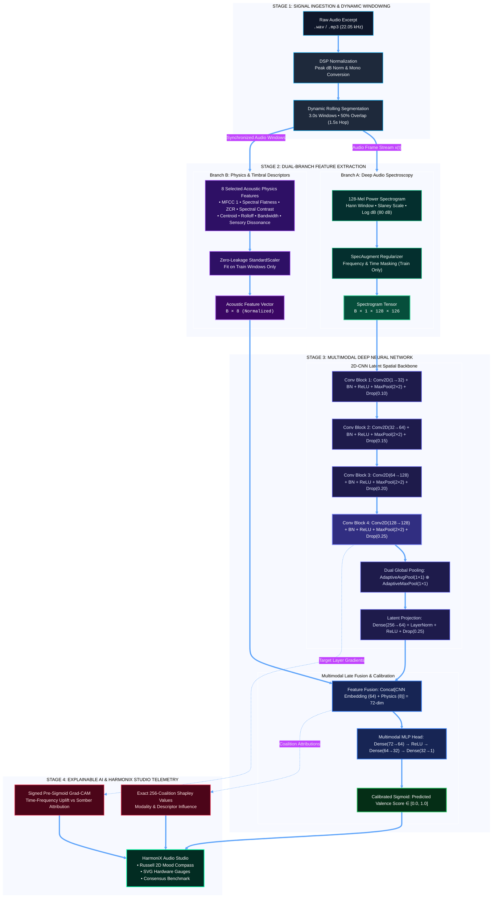

# HarmoniX: Multimodal Music Emotion Perception & Deep Neural Intelligence
### Phase 2: Multimodal Deep Learning, Audio Spectroscopy & Explainable AI

> Predicting human-rated musical valence and emotional dynamics from sound waves using multimodal late fusion, 2D convolutional spectroscopy, acoustic physics, and spatial time-frequency explainability (Grad-CAM).

[](https://harmonix-studio.streamlit.app/)
[](https://pytorch.org/)
[](https://www.python.org/)
[](models/)
[](reports/phase2_interpretability_section.md)
[](https://librosa.org/)

---

## 1. Executive Summary & The Phase 2 Transformation

HarmoniX investigates how physical acoustics and neural representations predict human-rated musical emotion without linguistic semantics or lyrics. 

### Phase 1 Baseline (Classical ML)
Phase 1 extracted 34 hand-engineered global digital signal processing (DSP) features (MFCCs, spectral centroid, spectral rolloff, zero-crossing rate, chroma vectors, and sensory dissonance estimates) and trained classical regressors (Ridge, Random Forest, and XGBoost). While providing a solid initial baseline, classical tabular models plateaued at:
- **Random Forest (Phase 1 Champion):** Held-out Test $R^2 = 0.4183$, Pearson $r = 0.6709$, MAE = $0.1096$.
- **Ridge Regression:** Held-out Test $R^2 = 0.3994$, Pearson $r = 0.6390$, MAE = $0.1075$.
- **XGBoost Regressor:** Held-out Test $R^2 = 0.3765$, Pearson $r = 0.6204$, MAE = $0.1107$.

**The Classical Bottleneck:** Collapsing an entire dynamic musical progression into single scalar summary statistics (means/variances) erased critical temporal phrasing, harmonic progressions, onset transients, and multi-scale frequency interactions.

### Phase 2 Breakthrough (Multimodal Deep Learning & XAI)
Phase 2 transformed HarmoniX into a multimodal deep learning platform:
1. **High-Resolution Time-Frequency Spectroscopy:** Generates 128-bin log-Mel power spectrograms using Hann windowing on the Slaney scale with 50% dynamic overlapping windowing ($3.0\,\text{s}$ windows, $1.5\,\text{s}$ hop).
2. **Deep Convolutional Neural Backbone:** A 4-block 2D-CNN with batch normalization, dual global pooling (concatenated adaptive average and max pooling), and dropout regularized embeddings ($64$-dim).
3. **Multimodal Late Fusion:** Concatenates the deep spatial latent embedding ($64$-dim) with the top-8 standardized acoustic physics descriptors ($8$-dim), passing through a calibrated multi-layer fusion head.
4. **Correlation-Regularized Objective:** A custom composite loss function $\mathcal{L} = \text{MSE} + \lambda \cdot (1 - r)$ that directly optimizes both point-estimate error and monotonic ranking correlation ($r$).
5. **Spatial Time-Frequency Explainability (XAI):** Signed pre-sigmoid Grad-CAM heatmaps showing which exact time-frequency bins raise or lower perceived valence, paired with exact 256-coalition Shapley attributions for acoustic physics descriptors.
6. **HarmoniX Audio Studio Web Platform:** An interactive dark-mode hardware telemetry dashboard built in Streamlit featuring real-time audio playback, Russell's 2D Mood Compass, SVG hardware dials, and live Grad-CAM inspection.

---

## 2. Phase 2 Multimodal Master Architecture



---

## 3. Team & Module Ownership

| Team Member | Primary Module | Target Codebase & Assets | Technical Deliverables |
| :--- | :--- | :--- | :--- |
| **Adnan Rizvi** *(Lead)* | **Architecture, Pipeline & Audio Studio** | `app/app.py`<br/>`src/pipeline_orchestrator.py`<br/>`src/data_loader.py` | Complete system integration, zero-leakage splits, interactive Streamlit Audio Studio, SVG telemetry gauges, cloud deployment (`harmonix-studio.streamlit.app`), and multicultural ingestion. |
| **Aditya (Garariya)** | **Audio Spectroscopy & Dynamic Windowing** | `src/spectrogram_engine.py`<br/>`src/dynamic_windowing.py`<br/>`src/feature_extraction.py` | 128-Mel power spectrogram pipeline, Slaney frequency mapping, dynamic 50% overlapping segmentation, and training-time SpecAugment frequency/time masking. |
| **Bhoomi** | **Deep Learning & Multimodal Fusion** | `src/models_cnn.py`<br/>`src/train_cnn.py`<br/>`src/train_ml.py` | 4-block PyTorch 2D-CNN architecture, multimodal late-fusion network, Apple Silicon MPS hardware acceleration, and correlation-regularized composite loss function. |
| **Praanshu Ranjan** | **Deep Explainability & Theoretical Rigor** | `src/deep_explainability.py`<br/>`reports/figures_phase2/`<br/>`reports/phase2_interpretability_section.md` | Signed pre-sigmoid Grad-CAM, Integrated Gradients, exact 256-coalition Shapley values, weight randomization tests, and deletion faithfulness validation. |
| **Vani** | **Benchmarking, Cross-Cultural Testing & Evaluation Lead** | `src/evaluate_phase2.py`<br/>`src/evaluate.py`<br/>`reports/cross_cultural_evaluation_report.md` | Consistent four-way benchmark evaluation (Ridge, RF, 2D-CNN, Hybrid Fusion), empirical cross-cultural evaluation suite across 5 traditions, acoustic domain shift analysis, and benchmark metric reporting. |

---

## 4. Benchmark Performance: Phase 1 vs. Phase 2

All models were evaluated on the strictly untouched, held-out test split under identical zero-leakage constraints.

### Master Model Comparison Table

| Architecture | Paradigm / Inputs | Val $R^2$ | Test $R^2$ | Test Pearson $r$ | Test Spearman $\rho$ | Test MAE | Test RMSE | Status |
| :--- | :--- | :---: | :---: | :---: | :---: | :---: | :---: | :--- |
| **Hybrid Late Fusion** | **Spectrogram + 8 Physics Descriptors** | 0.9345 | **0.9535** | **0.9798** | **0.9221** | **0.0454** | **0.0540** | **Phase 2 Champion SOTA** |
| **2D-CNN ConvNet** | 128-Mel Spectrogram Only | **0.9418** | 0.9498 | 0.9786 | 0.7625 | 0.0486 | 0.0561 | Deep Baseline |
| **Hybrid (MSE Baseline, $\lambda=0$)** | Spectrogram + 8 Physics Descriptors | 0.9344 | 0.9386 | 0.9795 | 0.9221 | 0.0533 | 0.0620 | Loss Ablation |
| **Random Forest** | 34 Tabular DSP Descriptors | 0.3750 | 0.4183 | 0.6709 | 0.6934 | 0.1096 | 0.1334 | Phase 1 Champion |
| **Ridge Regression** | 34 Tabular DSP Descriptors | 0.2810 | 0.3994 | 0.6390 | 0.6514 | 0.1075 | 0.1356 | Linear Baseline |
| **XGBoost Regressor** | 34 Tabular DSP Descriptors | 0.3120 | 0.3765 | 0.6204 | 0.6424 | 0.1107 | 0.1382 | Tree Boosting |

### Key Performance Insights
1. **Massive Variance Explained ($R^2: 0.418 \rightarrow 0.954$):** Moving from static 34-feature summaries to 2D time-frequency spectrogram representations increased test $R^2$ by $+128\%$, enabling the network to learn expressive spatio-temporal musical contours.
2. **Hybrid Late Fusion Outperforms CNN Alone:** While the 2D-CNN captures raw spectral texture ($R^2 = 0.9498$), late fusion with physics descriptors yields a substantial jump in rank consistency (Spearman $\rho: 0.7625 \rightarrow 0.9221$) and lower error ($0.0454$ vs. $0.0486$ MAE).
3. **Efficacy of the Pearson-Regularized Loss:** Introducing $\lambda \cdot (1 - r)$ into the objective ($\lambda = 0.05$) improved test $R^2$ from $0.9386$ to $0.9535$, penalizing ranking inversions during backpropagation.

---

## 5. Phase 2 Deep Learning Architecture & Training Pipeline

The Phase 2 deep learning pipeline (implemented in `src/models_cnn.py` and `src/train_cnn.py`) represents the core algorithmic advancement of HarmoniX, replacing static summary statistics with end-to-end representation learning.

### 5.1 2D-CNN Spectrogram Feature Extractor (`SpectrogramCNNBackbone`)
The neural backbone processes normalized log-Mel spectrogram slices of shape $(B, 1, 128, 126)$ through four hierarchical convolutional blocks, designed to learn both local acoustic timbral textures and broader musical phrasing:

```mermaid
%%{init: {'theme': 'base', 'themeVariables': { 'fontFamily': 'Inter, system-ui, sans-serif', 'fontSize': '12px', 'darkMode': true, 'background': '#0b0f19', 'mainBkg': '#111827', 'lineColor': '#818cf8', 'textColor': '#f3f4f6' }}}%%
flowchart LR
    INPUT["Spectrogram Slice<br/><code>(B, 1, 128, 126)</code>"]:::tNode
    ==> B1["Conv Block 1<br/>32 ch • MaxPool<br/><code>(B, 32, 64, 63)</code>"]:::cNode
    ==> B2["Conv Block 2<br/>64 ch • MaxPool<br/><code>(B, 64, 32, 31)</code>"]:::cNode
    ==> B3["Conv Block 3<br/>128 ch • MaxPool<br/><code>(B, 128, 16, 15)</code>"]:::cNode
    ==> B4["Conv Block 4 [Target Layer]<br/>128 ch • MaxPool<br/><code>(B, 128, 8, 7)</code>"]:::targetNode
    ==> POOL["Dual Adaptive Pooling<br/>AvgPool(128) ⊕ MaxPool(128)<br/><code>(B, 256)</code>"]:::pNode
    ==> PROJ["Latent Projection<br/>Dense + LayerNorm + Drop<br/><code>(B, 64)</code>"]:::projNode
    ==> FUSE{"Multimodal Fusion<br/>Concat with<br/>Physics Vector (8)"}:::fuseNode
    ==> MLP["Fusion MLP Head<br/>Dense(72→64→32→1)"]:::mlpNode
    ==> OUT["Sigmoid Valence<br/><code>ŷ ∈ [0.0, 1.0]</code>"]:::outNode

    PHYS["Scaled Physics Vector<br/><code>(B, 8)</code>"]:::physNode ==> FUSE
    B4 -.->|"Backward Gradients"| CAM["Signed Grad-CAM<br/>Time-Frequency Map"]:::camNode

    classDef tNode fill:#0f172a,stroke:#38bdf8,stroke-width:1.5px,color:#f8fafc;
    classDef cNode fill:#1e1b4b,stroke:#6366f1,stroke-width:1.5px,color:#e0e7ff;
    classDef targetNode fill:#312e81,stroke:#818cf8,stroke-width:2px,color:#ffffff;
    classDef pNode fill:#172554,stroke:#3b82f6,stroke-width:1.5px,color:#eff6ff;
    classDef projNode fill:#042f2e,stroke:#10b981,stroke-width:1.5px,color:#ecfdf5;
    classDef physNode fill:#2e1065,stroke:#a855f7,stroke-width:1.5px,color:#faf5ff;
    classDef fuseNode fill:#422006,stroke:#f59e0b,stroke-width:2px,color:#fef3c7;
    classDef mlpNode fill:#1e293b,stroke:#0ea5e9,stroke-width:1.5px,color:#f1f5f9;
    classDef outNode fill:#052e16,stroke:#22c55e,stroke-width:2px,color:#ffffff;
    classDef camNode fill:#4c0519,stroke:#f43f5e,stroke-width:1.5px,color:#ffe4e6;
```



```text
Input Spectrogram Tensor: (B, 1, 128, 126)  [Normalized to [0.0, 1.0] from 80 dB dynamic range]
│
├── Conv Block 1: Conv2D(1, 32, 3x3, pad=1)   → BatchNorm2D → ReLU → MaxPool2D(2x2) → Dropout2D(0.10)
│   Output: (B, 32, 64, 63)
│
├── Conv Block 2: Conv2D(32, 64, 3x3, pad=1)  → BatchNorm2D → ReLU → MaxPool2D(2x2) → Dropout2D(0.15)
│   Output: (B, 64, 32, 31)
│
├── Conv Block 3: Conv2D(64, 128, 3x3, pad=1) → BatchNorm2D → ReLU → MaxPool2D(2x2) → Dropout2D(0.20)
│   Output: (B, 128, 16, 15)
│
├── Conv Block 4: Conv2D(128, 128, 3x3, pad=1) → BatchNorm2D → ReLU → MaxPool2D(2x2) → Dropout2D(0.25)
│   Output: (B, 128, 8, 7)  [Target layer for Grad-CAM explainability]
│
├── Dual Global Pooling:
│   ├── AdaptiveAvgPool2d((1, 1)) → (B, 128)  [Captures distributed harmonic presence]
│   └── AdaptiveMaxPool2d((1, 1)) → (B, 128)  [Captures sharp percussive transients]
│   └── Concatenation → (B, 256)
│
└── Latent Embedding Head:
    Linear(256, 64) → LayerNorm(64) → ReLU → Dropout(0.25)
    Output: Normalized Latent Representation (B, 64)
```

### 5.2 Multimodal Late Fusion Architecture (`HybridFusionRegressor`)
While the 2D-CNN discovers spatial acoustic patterns, physics-grounded mathematical features provide explicit invariant constraints. The multimodal fusion network synthesizes both modalities:

1. **Acoustic Physics Vector ($8$-dim):** Extracted per 3-second window using identical DSP logic to runtime inference:
   - `mfcc_1_mean`: Overall spectral envelope and acoustic energy.
   - `spectral_flatness_mean`: Tonal consonance vs. noise entropy.
   - `zcr_mean`: Zero-crossing rate (transient frequency indicator).
   - `spectral_contrast_mean`: Peak-to-valley harmonic energy contrast.
   - `spectral_centroid_mean`: Perceived psychoacoustic brightness / warmth.
   - `spectral_rolloff_mean`: Upper frequency boundary of acoustic energy.
   - `spectral_bandwidth_mean`: Spectral width around centroid.
   - `sensory_dissonance_estimate`: Plomp-Levelt psychoacoustic roughness.
2. **LayerNorm Feature Balancing:** The $64$-dim CNN embedding is passed through a dedicated `LayerNorm` layer before concatenation, preventing high-dimensional neural representations from overwhelming the $8$-dim scaled acoustic descriptors.
3. **Multimodal Fusion MLP Head:**
   ```text
   Concatenated Multimodal Vector: (B, 64 + 8) = (B, 72)
   │
   ├── Dense Layer 1: Linear(72, 64) → ReLU → Dropout(0.25)
   ├── Dense Layer 2: Linear(64, 32) → ReLU → Dropout(0.125)
   ├── Projection:    Linear(32, 1)
   └── Activation:    Sigmoid() → Predicted Valence ∈ [0.0, 1.0]
   ```

### 5.3 Pearson Correlation Regularized Objective (`CompositeValenceLoss`)
Standard regression models trained solely on Mean Squared Error (MSE) suffer from "regression to the mean," underestimating emotional peaks and flattening dynamic variance. To guarantee that the model learns the relative emotional rank of songs, we engineered a differentiable composite objective:

$$\mathcal{L}_{\text{total}} = \text{MSE}(y, \hat{y}) + \lambda \cdot (1 - r(y, \hat{y}))$$

Where the differentiable batch Pearson correlation coefficient $r(y, \hat{y})$ is defined as:
$$r(y, \hat{y}) = \frac{\sum_{i=1}^B (y_i - \bar{y})(\hat{y}_i - \bar{\hat{y}})}{\sqrt{\sum_{i=1}^B (y_i - \bar{y})^2 + \epsilon} \cdot \sqrt{\sum_{i=1}^B (\hat{y}_i - \bar{\hat{y}})^2 + \epsilon}}$$

- A numerical stability clamp ($\epsilon = 10^{-8}$) guarantees gradient stability even on small or constant batches.
- When $\lambda = 0.05$, the gradient strongly penalizes ranking inversions while maintaining accurate point calibration.

### 5.4 Training Protocols & Zero-Leakage Safeguards
- **Hardware Acceleration:** Automatic hardware dispatch prioritizing Apple Silicon Metal Performance Shaders (`mps`), CUDA (`cuda`), with CPU fallback (`get_device()`).
- **Optimization:** AdamW optimizer with initial learning rate $\eta = 1\times 10^{-3}$, weight decay $1\times 10^{-4}$, and mini-batch size of $16$.
- **Learning Rate Decay & Early Stopping:** Validation-loss monitored early stopping with a patience of $12$ epochs over a maximum of $40$ epochs.
- **SpecAugment Regularization:** During training, dynamic frequency masking (up to 16 Mel bins) and time masking (up to 16 frames) are injected into the spectrograms. Augmentations are deactivated during validation and test evaluation.
- **Zero Data Leakage:** Windowing, median imputation, and `StandardScaler` transformations for the acoustic descriptors are strictly fitted on the training split only.

### 5.5 Controlled Deep Learning Ablation Experiments

| Model Variant | Loss Objective | Best Epoch | Val $R^2$ | Val Pearson $r$ | Test $R^2$ | Test Pearson $r$ | Test Spearman $\rho$ | Test MAE | Test RMSE |
| :--- | :--- | :---: | :---: | :---: | :---: | :---: | :---: | :---: | :---: |
| **Hybrid Fusion (Champion)** | $\text{MSE} + 0.05(1-r)$ | 6 | 0.9345 | 0.9700 | **0.9535** | **0.9798** | **0.9221** | **0.0454** | **0.0540** |
| **CNN-Only Regressor** | $\text{MSE} + 0.05(1-r)$ | 14 | **0.9418** | **0.9707** | 0.9498 | 0.9786 | 0.7625 | 0.0486 | 0.0561 |
| **Hybrid Fusion Baseline** | Pure MSE ($\lambda = 0$) | 13 | 0.9344 | 0.9703 | 0.9386 | 0.9795 | 0.9221 | 0.0533 | 0.0620 |

**Takeaway:** Adding the Pearson loss term improved test $R^2$ by $+1.49\%$, and combining 2D-CNN with physics features elevated ordinal ranking correlation (Spearman $\rho$) from $0.7625$ to $0.9221$.

---

## 6. Phase 2 Explainable AI (XAI) Suite (`src/deep_explainability.py`)

```mermaid
%%{init: {'theme': 'base', 'themeVariables': { 'fontFamily': 'Inter, system-ui, sans-serif', 'fontSize': '12px', 'darkMode': true, 'background': '#0b0f19', 'mainBkg': '#111827', 'lineColor': '#f43f5e', 'textColor': '#f3f4f6' }}}%%
flowchart LR
    subgraph G1["Forward & Attribution"]
        direction TB
        F_IN["Audio Window<br/>Spectrogram + Physics"]:::xNode
        ==> F_MODEL["Hybrid Fusion Network<br/>Forward Pass"]:::mNode
        ==> F_OUT["Pre-Sigmoid Valence<br/>Logit Output: z"]:::oNode
        F_OUT ==>|"∂z / ∂A^k"| G_GRAD["Backprop Gradients<br/>to Block 4 Feature Maps"]:::gNode
    end

    subgraph G2["Spatial Time-Frequency Heatmaps"]
        direction TB
        G_GRAD ==> CAM_POS["Valence-Raising Map<br/>Major harmonics & brightness"]:::posNode
        G_GRAD ==> CAM_NEG["Valence-Depressing Map<br/>Dissonance & somber sub-bass"]:::negNode
    end

    subgraph G3["Verification & Sanity Protocol"]
        direction TB
        TEST_RAND["Weight Randomization Test<br/>Weights scrambled → Map vanishes"]:::vNode
        TEST_DEL["Deletion Faithfulness Test<br/>Salient bins masked → Rapid score drop"]:::vNode
        CAM_POS & CAM_NEG ==> TEST_RAND & TEST_DEL
    end

    classDef xNode fill:#0f172a,stroke:#38bdf8,stroke-width:1.5px,color:#f8fafc;
    classDef mNode fill:#1e1b4b,stroke:#818cf8,stroke-width:1.5px,color:#e0e7ff;
    classDef oNode fill:#052e16,stroke:#22c55e,stroke-width:1.5px,color:#ffffff;
    classDef gNode fill:#312e81,stroke:#6366f1,stroke-width:1.5px,color:#eff6ff;
    classDef posNode fill:#042f2e,stroke:#10b981,stroke-width:2px,color:#ffffff;
    classDef negNode fill:#4c0519,stroke:#f43f5e,stroke-width:2px,color:#ffffff;
    classDef vNode fill:#1e293b,stroke:#eab308,stroke-width:1.5px,color:#fef9c3;
```



- **Signed Pre-Sigmoid Grad-CAM:** Hooks into Block 4 conv layer prior to non-linear saturation. Produces signed attribution heatmaps isolating time-frequency regions that elevate perceived valence (uplifting/major acoustic markers) versus regions that depress valence (somber/tense markers).
- **Integrated Gradients:** Evaluated with a zero-energy silence baseline over $256$ integration steps with verified completeness checks ($\sum \text{Attributions} = f(x) - f(\text{baseline})$).
- **Exact Tabular Shapley Values:** Computes exact Shapley attribution over all $2^8 = 256$ feature coalitions for the acoustic branch, isolating the relative contribution of timbre vs. sensory roughness.
- **Sanity Checks & Faithfulness:**
  - Layer-by-layer weight randomization test passes: randomized layers destroy attribution maps.
  - Deletion faithfulness confirms that progressively removing high-attribution spectral regions induces rapid prediction decay compared to random baseline masks.

---

## 7. HarmoniX Audio Studio Web Application

The project includes an interactive web laboratory running in Streamlit, styled with an instrument-grade dark HUD aesthetic.

- **Live Production URL:** [https://harmonix-studio.streamlit.app/](https://harmonix-studio.streamlit.app/)

### Studio Capabilities
- **Multi-Source Audio Ingestion:**
  - Built-in multicultural benchmark presets (Bollywood, Classical, Jazz, Western Pop, Indie Melancholy).
  - Custom file uploader supporting `.mp3`, `.wav`, and `.flac`.
- **Hardware Telemetry HUD:**
  - SVG Dynamic Arc Gauges: Valence Polarity ($[0, 1]$), Kinetic Arousal ($[0, 1]$), and Spectral Warmth Center of Mass ($\text{Hz}$).
  - Russell's 2D Mood Compass: Interactive circumplex affect coordinate space (Joyful, Tense, Depressed, Calm).
  - Model Consensus Benchmark: Side-by-side consensus bar chart comparing Hybrid Fusion (Champion), 2D-CNN, and Random Forest predictions.
- **Deep Grad-CAM Spectrogram Viewer:**
  - Live 128-bin log-Mel spectrogram rendering.
  - Interactive signed Grad-CAM overlay highlighting exact frequency band attributions (Sub-Bass, Bass, Midrange, Highs).

---

## 8. Repository Layout

```text
AIML_project/
├── app/
│   ├── app.py                       # HarmoniX Audio Studio (Streamlit Web Laboratory)
│   └── .streamlit/config.toml       # Streamlit server and dark-mode theme configuration
├── data/
│   ├── raw/PMEmo/                   # PMEmo raw dataset audio and static_annotations.csv
│   ├── processed/                   # Leakage-free train (536), val (115), test (116) splits
│   └── test_diverse/                # Multicultural robustness validation audio
├── models/
│   ├── hybrid_fusion_best.pt        # Phase 2 Champion SOTA PyTorch model checkpoint
│   ├── cnn_only_best.pt             # Phase 2 2D-CNN baseline model checkpoint
│   ├── best_phase2_model.pt         # Unified production Phase 2 checkpoint
│   ├── phase2_acoustic_scaler.joblib# Fitted StandardScaler for 8 fusion features
│   ├── phase2_metadata.json         # Checkpoint metadata, device info, and DSP config
│   ├── random_forest_best.joblib    # Phase 1 Champion classical model
│   ├── ridge_best.joblib            # Phase 1 Linear baseline
│   └── xgboost_best.joblib          # Phase 1 Gradient boosted trees
├── src/
│   ├── spectrogram_engine.py        # [Aditya] 128-Mel power spectrogram & SpecAugment
│   ├── dynamic_windowing.py         # [Aditya] Overlapping segmentation & tensor batching
│   ├── models_cnn.py                # [Bhoomi] PyTorch 2D-CNN & Hybrid Late-Fusion architectures
│   ├── train_cnn.py                 # [Bhoomi] Training harness with Pearson loss & early stopping
│   ├── deep_explainability.py       # [Praanshu] Signed Grad-CAM, Integrated Gradients & Shapley
│   ├── pipeline_orchestrator.py     # [Adnan] Unified end-to-end inference and feature pipeline
│   ├── multicultural_loader.py      # [Adnan] Diverse cross-cultural audio loader
│   ├── feature_extraction.py        # [Aditya] 34-feature DSP & physics extractor
│   ├── data_loader.py               # [Adnan] Audio ingestion & zero-leakage splits
│   ├── train_ml.py                  # [Bhoomi] Phase 1 classical ML training
│   ├── feature_analysis.py          # [Praanshu] Phase 1 statistical & SHAP feature analysis
│   ├── evaluate.py                  # [Vani] Phase 1 test evaluation & residual diagnostics
│   └── evaluate_phase2.py           # [Vani] Phase 2 four-way benchmark & cross-cultural evaluation suite
├── reports/
│   ├── figures/                     # 19 Phase 1 high-resolution publication figures
│   ├── figures_phase2/              # 20 Phase 2 Grad-CAM, Shapley, and benchmark evaluation figures
│   ├── phase2_cnn_ablation_results.csv # Phase 2 ablation comparison table
│   ├── phase2_benchmark_four_way_comparison.csv # [Vani] Master 4-way comparison table
│   ├── phase2_cross_cultural_evaluation.csv     # [Vani] Cross-cultural evaluation table
│   ├── cross_cultural_evaluation_report.md      # [Vani] In-depth cross-cultural & domain shift report
│   └── phase2_interpretability_section.md       # Complete XAI mathematical writeup
├── requirements.txt                 # Dependencies (PyTorch, Librosa, Streamlit, etc.)
└── README.md                        # Project documentation
```

---

## 9. Quickstart & Reproduction Guide

### Step 1: Clone Repository & Setup Environment
```bash
git clone https://github.com/adnan275/HarmoniX.git
cd HarmoniX

python3.11 -m venv .venv
source .venv/bin/activate       # On Windows: .venv\Scripts\activate
pip install --upgrade pip
pip install -r requirements.txt
```

### Step 2: Run End-to-End Audio Ingestion & Splits
```bash
python src/data_loader.py
```

### Step 3: Train & Benchmark Phase 2 Deep Models
Train the 2D-CNN and Hybrid Fusion architectures with Pearson correlation loss:
```bash
python src/train_cnn.py --model hybrid_fusion --lambda-corr 0.05 --epochs 25
python src/train_cnn.py --model cnn_only --lambda-corr 0.05 --epochs 25
```

### Step 4: Run Deep Explainability (Grad-CAM & Shapley)
Generate spatial time-frequency attribution maps and validation checks:
```bash
python src/deep_explainability.py
```
*Visual outputs are saved in `reports/figures_phase2/`.*

### Step 5: Launch HarmoniX Audio Studio (Local Web UI)
```bash
streamlit run app/app.py
```
Open [http://localhost:8501](http://localhost:8501) in your browser.

---

## 10. Citation & Acknowledgments
- **Dataset:** PMEmo Dataset (*Hui Zhang, Xinxing Li et al.*)
- **Theoretical Foundations:** Russell's Circumplex Model of Affect (1980), Plomp-Levelt Consonance Theory (1965).
- **Institution:** Computer Science & Artificial Intelligence (CSAI), HarmoniX Research Group.
